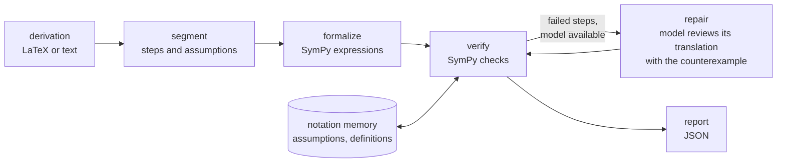

# DerivCheck

[](https://github.com/levsan13/DerivCheck/actions/workflows/ci.yml)
[](LICENSE)
[](pyproject.toml)

**An agent that reads a derivation from a physics paper, splits it into steps, checks every
step with SymPy and returns a JSON report.**

> **Resumo (pt-BR).** O DerivCheck lê uma dedução de um artigo de física, quebra em etapas,
> traduz cada etapa para o SymPy e confere se ela decorre da anterior: identidades exatas
> por álgebra simbólica e por pontos aleatórios, aproximações por série até a ordem mantida.
> Um agente em LangGraph coordena o processo. Com um modelo de linguagem (LM Studio, Ollama,
> OpenAI ou Claude), o modelo formaliza o texto e revisa as etapas que falham, a partir do
> contraexemplo do verificador; sem modelo, regras de LaTeX fazem a segmentação. A saída é
> um relatório JSON com o veredito de cada etapa.

## Why

Derivations in papers skip steps, drop factors of 2 and approximate without saying to which
order. Checking them by hand is slow, and asking a language model is not a check: the model
tends to agree with a wrong step. DerivCheck splits the work:

* the language model only **translates** (text to SymPy) and, when a step fails, reviews
  its own translation;
* every verdict comes from **computer algebra**, with a counterexample when a step fails
  and the leading neglected term when an approximation holds.

## How it works

The agent is a [LangGraph](https://github.com/langchain-ai/langgraph) state machine:



| Node | Offline | With a language model |
|---|---|---|
| `segment` | LaTeX rules: rows of display math and chains of `=` / `\approx`, inline definitions (`where $\omega = \sqrt{k/m}$`), assumptions (`$m, c > 0$`), expansion cues ("for small $p$, to second order in $p$") | the model splits the text and writes each step in SymPy syntax, as structured JSON |
| `formalize` | SymPy's LaTeX parser plus the usual physics readings: `e^{i x}`, `i`, `\hbar`, `\Delta E`, `\omega_c(n + 1/2)`, `v_{F}` | the model's strings, parsed through a whitelist with Python builtins switched off |
| `verify` | deterministic, same in both modes (below) | |
| `repair` | | the model sees each failing step with the checker's result and either fixes a transcription mistake or confirms that the step as written is wrong; bounded by `--max-repairs`, and every replaced translation stays in the report |

If the model cannot be reached, `segment` falls back to the LaTeX rules.

### What "checked" means

| Relation | Check |
|---|---|
| `equals` | random points at 30 digits (gives a counterexample when the sides differ), then a symbolic proof (`simplify` and friends) under a time limit |
| `approx` | series of the difference in the small variable: every term up to the order kept must vanish; the leading neglected term is reported |
| `solve` | the solution substituted into the previous equation |
| `equivalent` | the new equation is a nonzero constant times the previous one |
| `given`, `definition` | stored in the notation memory and substituted into later comparisons |

The **notation memory** holds assumptions and definitions. Assumptions decide which
simplifications are valid: `sqrt(m**2*c**4) = m*c**2` holds only for positive `m` and `c`,
and a step that is true only for positive values is reported as `unverified` with that
hint, not as an error. Definitions may come after the equation that uses them ("..., where
$x = A\cos\omega t$"). With `--memory notation.json` the memory is saved and reused by other
derivations of the same paper.

## Installation

```bash
git clone https://github.com/levsan13/DerivCheck.git
cd DerivCheck
pip install -e ".[dev]"        # add [claude] for the Anthropic backend
```

Python 3.10+. Dependencies: SymPy (with its ANTLR LaTeX parser), LangGraph and Pydantic.

## Quick start

[`examples/relativistic_limit.tex`](examples/relativistic_limit.tex):

```latex
For a free particle of mass $m$, with $m, c > 0$, the relativistic energy is
\begin{align}
  E &= \sqrt{p^2 c^2 + m^2 c^4} \\
    &= m c^2 \sqrt{1 + \frac{p^2}{m^2 c^2}} .
\end{align}
Expanding the square root for small $p$, to second order in $p$, ...
\begin{equation}
  E \approx m c^2 + \frac{p^2}{2m} .
\end{equation}
```

```console
$ derivcheck examples/relativistic_limit.tex -o report.json
DerivCheck 0.1.0 | offline | examples/relativistic_limit.tex
   1   --  given                E = sqrt(c**4*m**2 + c**2*p**2)
   2   ok  verified             E = c**2*m*sqrt(1 + p**2/(c**2*m**2))  [symbolic]
   3   ok  verified_to_order    E ~ c**2*m + p**2/(2*m)  [series in p]
          the two sides agree up to order p**2; leading difference -p**4/(8*c**2*m**3)
verdict: consistent (2/2 checked steps verified)
```

A derivation with a dropped factor of 2
([`examples/kinetic_energy_error.tex`](examples/kinetic_energy_error.tex)):

```console
$ derivcheck examples/kinetic_energy_error.tex -o report.json
DerivCheck 0.1.0 | offline | examples/kinetic_energy_error.tex
   1  def  definition           p := hbar*k
   2   --  given                E = p**2/(2*m)
   3 FAIL  failed               E = hbar**2*k**2/m  [numeric]
          the two sides differ: 0.542753 vs 1.08551 at the counterexample
          counterexample: hbar = 1.08005, k = -0.716783, m = 0.552116
verdict: error_found (0/1 checked steps verified, first failure at step 3)
```

The exit code is 0 when the derivation is consistent, 1 when a step fails and 3 when some
step could not be checked, so DerivCheck can run in CI over the derivations of a manuscript.
The full reports are in [`examples/`](examples).

## With a language model

```bash
derivcheck section.tex --llm lmstudio                # first model loaded in LM Studio
derivcheck section.tex --llm lmstudio:qwen3-32b      # a specific local model
derivcheck section.tex --llm ollama:qwen3:32b
derivcheck section.tex --llm openai:<model>          # OPENAI_API_KEY (OPENAI_BASE_URL for compatible servers)
derivcheck section.tex --llm claude:<model>          # ANTHROPIC_API_KEY, pip install -e ".[claude]"
```

`DERIVCHECK_LLM` sets the default backend; `LMSTUDIO_HOST`, `LMSTUDIO_MODEL` and
`OLLAMA_HOST` set the local servers. `<think>` blocks of reasoning models are ignored.
The model is asked to transcribe, not to judge: the repair prompt says that a faithful
translation of a wrong step must be kept, and the report records every translation the
model replaced (`history`), so a "fixed" step can always be audited.

## Python API

```python
from derivcheck import Memory, check_derivation

text = open("examples/harmonic_oscillator.tex").read()
report = check_derivation(text, "offline", memory=Memory({"A": "positive"}))
print(report.summary.verdict)                      # consistent
for step in report.steps:
    print(step.index, step.check.status, step.lhs, "=", step.rhs)
```

`derivcheck.build_graph()` returns the compiled LangGraph. Any subclass of
`derivcheck.llm.Backend` that implements `complete(system, user) -> str` can serve as the
model; `tests/conftest.py` has a scripted one that the tests use to drive the repair loop.

## Benchmark

`derivcheck bench` runs ten derivations with known verdicts: six correct (relativistic
limit, oscillator energy, double-angle identity, Euler's formula, Gaussian integral, Landau
level spacing) and four with planted errors (wrong expansion coefficient, dropped factor 2,
$(a+b)^2 = a^2 + b^2$, wrong Fermi velocity of graphene). A case passes when the verdict is
right and the first step flagged is the planted one.

```console
$ derivcheck bench
derivcheck bench | backend offline | 10 cases
  case                            expected     verdict      step       s  result
  relativistic_limit              consistent   consistent      -    0.45  pass
  relativistic_wrong_coefficient  error_found  error_found     2    0.06  pass
  oscillator_energy               consistent   consistent      -    0.17  pass
  kinetic_energy_factor_two       error_found  error_found     3    0.02  pass
  double_angle                    consistent   consistent      -    0.09  pass
  euler_formula                   consistent   consistent      -    0.09  pass
  gaussian_integral               consistent   consistent      -    0.11  pass
  square_of_sum                   error_found  error_found     1    0.01  pass
  landau_level_spacing            consistent   consistent      -    0.08  pass
  dirac_cone_wrong_velocity       error_found  error_found     3    0.04  pass
passed 10/10; LLM calls 0; time per node: segment 0.31s, formalize 0.40s, verify 0.38s
```

The same cases with `--llm` measure how well a model formalizes physics text, with the
number of model calls and repairs per case, which makes it easy to compare local models.

## The report

Each step carries the LaTeX as written, its SymPy translation, the relation to what came
before, the justification found in the text and a `check`:

```json
{
  "index": 3,
  "latex": "E \\approx m c^2 + \\frac{p^2}{2m}",
  "lhs": "E",
  "rhs": "c**2*m + p**2/(2*m)",
  "relation": "approx",
  "expansion": {"variable": "p", "point": "0", "order": 2},
  "check": {
    "status": "verified_to_order",
    "method": "series in p",
    "against": 2,
    "detail": "the two sides agree up to order p**2; leading difference -p**4/(8*c**2*m**3)"
  },
  "attempts": 0,
  "repaired": false,
  "history": []
}
```

`status` is one of `given`, `definition`, `verified`, `numerically_verified`,
`verified_to_order`, `failed`, `unparsed` and `unverified`. The report also has the
assumptions and definitions used, a summary (verdict, first failure, model calls, repairs)
and a trace with the time spent in each node.

## Limitations

* The offline segmenter expects derivations typeset as chains of relations; text that
  explains steps in prose needs a language model.
* Scalar algebra and calculus only: operators, matrices and vector identities are not
  translated yet.
* `numerically_verified` means agreement at random points, not a proof.
* Approximations are series in one small variable around a point.
* A wrong translation can make a wrong step look right. The checker cannot see that; the
  `history` field and the LaTeX kept next to each translation are there to audit it.

## License

MIT, see [LICENSE](LICENSE).
